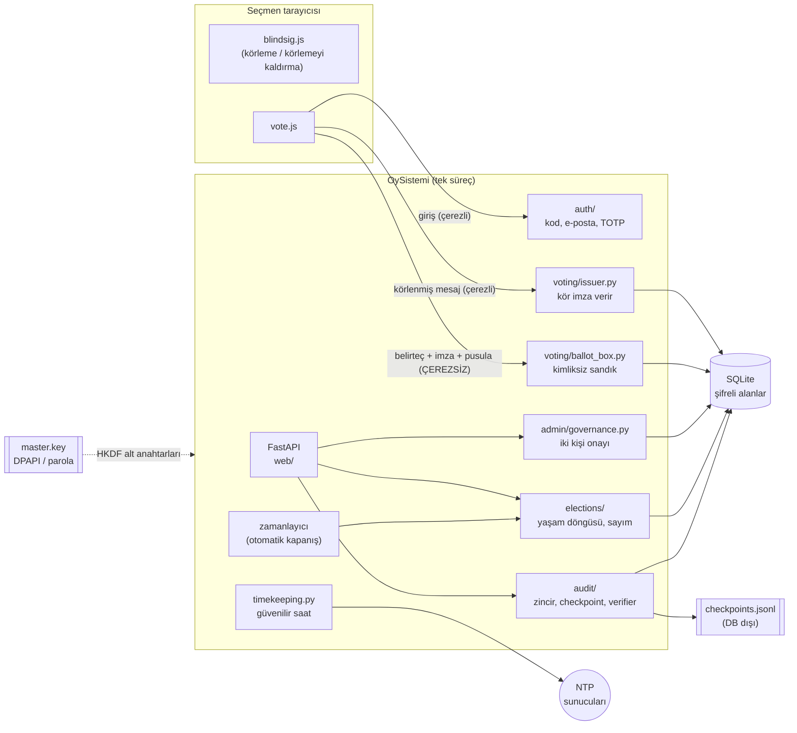
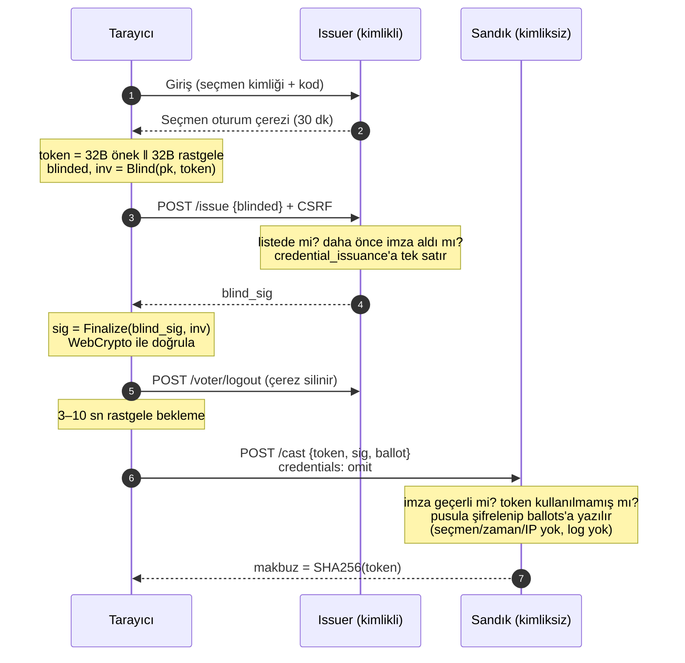
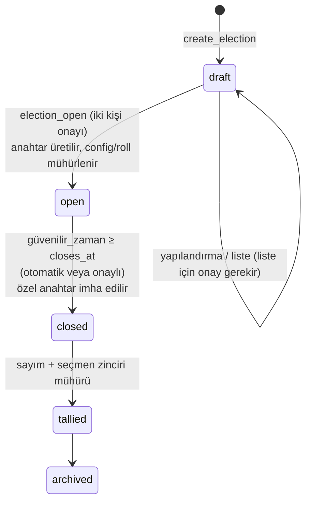

# Mimari

## Bileşenler



## Oy verme akışı



Sunucu yalnızca `blinded` değerini görür. `r` körleme faktörü rastgele olduğu için `blinded` ile
sonradan gelen `(token, sig)` arasında hesaplanabilir bir bağ yoktur.

## Oylama yaşam döngüsü



Geçişler hem uygulamada hem de `elections_status_flow` tetikleyicisinde denetlenir.

## Veritabanı

| Tablo | Taraf | İçerik | Koruma |
|---|---|---|---|
| `voters` | Kimlik | id, **şifreli** ad/e-posta, durum | row MAC, silinemez, gölge log |
| `admins` | Kimlik | argon2 parola, **şifreli** TOTP sırrı, rol | row MAC, silinemez, gölge log |
| `elections` | — | yapılandırma, mühürler, açık anahtar, sarmalanmış özel anahtar, sonuç | row MAC, durum makinesi, dondurma |
| `election_voters` | Kimlik | oylama ↔ seçmen listesi | row MAC, açılışta donar, gölge log |
| `auth_codes` | Kimlik | argon2 kod özeti, deneme sayacı | row MAC |
| `credential_issuance` | Kimlik | seçmen başına tek kör imza | PK (tekillik), salt ekleme, **gölge log yok** |
| `ballots` | **Sandık** | token, imza, **şifreli** pusula | PK (tekillik), salt ekleme, `WITHOUT ROWID`, **seçmen/zaman yok** |
| `change_requests` / `approvals` | Yönetişim | **şifreli** öneri yükü, onaylar | row MAC / salt ekleme |
| `audit_log` | Ayak izi | HMAC zinciri, **şifreli** yük | salt ekleme, zaman monotonluğu |
| `voter_log` | Ayak izi | oylama başına seçmen olay zinciri | salt ekleme, kapanışta ana zincire mühür |
| `shadow_log` | Ayak izi | tetikleyici kaydı (+ audit_seq) | salt ekleme |
| `checkpoints` | Ayak izi | HMAC'li durum özetleri (DB dışına da yazılır) | salt ekleme |

`credential_issuance` ve `ballots` bilinçli olarak gölge loga **alınmaz**. Otomatik artan sıra
numaraları ve zaman damgaları, oy ile seçmen arasında yan kanal oluştururdu.

## Anahtar hiyerarşisi

```
master.key (32 B; DPAPI veya scrypt+AES-GCM ile korunur)
 └─ HKDF-SHA256
     ├─ oysistemi/rowmac      satır MAC'leri
     ├─ oysistemi/audit       denetim ve seçmen zinciri MAC'leri
     ├─ oysistemi/checkpoint  checkpoint MAC'leri
     ├─ oysistemi/wrap        seçim özel anahtarları ve TOTP sırları (AES-GCM)
     ├─ oysistemi/session     oturum çerezi imzaları
     └─ oysistemi/field       alan şifreleme (AES-256-GCM)

Oylama başına: RSA-3072 kör imza anahtarı (wrap ile sarmalı; kapanışta imha)
```

## HTTP uç noktaları

| Yöntem ve yol | Bölge | Açıklama |
|---|---|---|
| `GET /` | Kamu | Açık ve sonuçlanmış oylamalar |
| `GET /e/{id}` | Kamu | Seçmen giriş sayfası |
| `POST /e/{id}/login` | Kimlik | Basılı kod / e-posta kodu doğrulama |
| `POST /e/{id}/email` | Kimlik | E-posta kodu isteği (her durumda aynı yanıt) |
| `GET /e/{id}/vote` | Kimlik | Pusula |
| `POST /api/e/{id}/issue` | Kimlik | Kör imza (çerez + CSRF başlığı) |
| `POST /voter/logout` | Kimlik | Seçmen oturumunu kapatır |
| `GET /api/e/{id}/key` | Kamu | Oylamanın açık anahtarı |
| `POST /api/e/{id}/cast` | **Sandık** | Kimliksiz oy (çerez/IP/log yok) |
| `GET /e/{id}/results` | Kamu | Sonuç (yalnızca sayımdan sonra) |
| `GET /api/e/{id}/bulletin.json` | Kamu | İlan panosu (yalnızca sayımdan sonra) |
| `/admin/...` | Yönetim | Giriş, TOTP, pano, onaylar, seçmenler, yöneticiler, oylamalar, kodlar, ayak izi, bütünlük |

## Modül haritası

| Modül | Sorumluluk |
|---|---|
| `config.py` | Ayarlar, HKDF alt anahtarları, ana anahtar oluşturma |
| `context.py` | Bağlantı + anahtar + ayar bağlamı, kurulum, saat yapılandırması |
| `timekeeping.py` | `TrustedClock`: NTP uzlaşması, monotonik çapa, alarmlar |
| `osprotect.py` | Windows ACL / POSIX izinleri |
| `backup.py` | Şifreli yedek / geri yükleme |
| `db/connection.py` | PRAGMA'lar, işlem yardımcısı, MAC'li satır yazımı, şema parmak izi |
| `db/schema.sql` | Tablolar ve tüm güvenlik tetikleyicileri |
| `crypto/blind_rsa.py` | RFC 9474 (sunucu tarafı ve test için istemci tarafı) |
| `crypto/fieldenc.py` | AAD'li alan şifreleme |
| `crypto/keyfile.py`, `crypto/dpapi.py` | Ana anahtar koruma modları, kurtarma |
| `crypto/keystore.py` | Seçim özel anahtarlarının sarmalanması |
| `crypto/rowmac.py` | Satır MAC'leri |
| `audit/chain.py` | Denetim ve seçmen zincirleri, en yüksek su işareti |
| `audit/checkpoint.py` | Checkpoint üretimi ve karşılaştırma |
| `audit/verifier.py` | Tüm bütünlük denetimleri |
| `admin/governance.py` | Öneri/onay, seçmen ve yönetici değişiklikleri |
| `auth/` | Seçmen kodları, yönetici parola + TOTP, e-posta |
| `elections/` | Yapılandırma doğrulama, durum makinesi, sayım, ilan panosu, otomatik kapanış |
| `elections/ballot_types/` | Oy türü eklentileri |
| `voting/` | Issuer ve sandık |
| `web/` | Rotalar, güvenlik ara katmanı, şablonlar, tarayıcı kodu |
